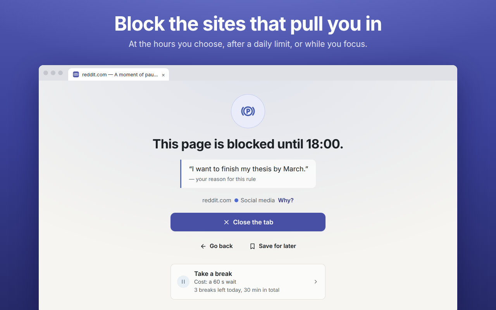

# WebHandbrake

**Block distracting websites, or slow them down so that you go in only when you mean to.**

WebHandbrake is a free, open-source browser extension for Chrome, Firefox and Firefox for Android.
Choose the sites, when each rule applies and what happens. Making a rule stricter is instant;
loosening it takes what you chose for it, so a moment of impulse cannot undo it. No account, no
tracking: everything stays on your device.



## What it does

- **Block** during work hours, after a daily time limit or for a focus session. Most pages are
  stopped before they load, from the moment the browser starts. Need a site for a minute? Take a
  break, with the length, number and cost you set.
- **Slow down instead of blocking**: say what you want to do before the site opens, wait for a
  short countdown, type random characters, or use a visual filter, a redirect or a closed tab.
- **Rules that fit your day**: time windows (overnight too), and time and visit limits that start
  again every hour, day or so many days. Start from a ready-made list or paste your own
  domains, pages, wildcards, regular expressions and exceptions. **Why?** tells you which rule
  applies and when that changes.
- **Easy to tighten, hard to undo**: each rule has its protection: a reminder, a wait of the length
  you choose, a password, a code from a trusted person's authenticator app, a lock until a date, or
  permanent. An emergency exit always works: you wait (24 hours by default), then type a sentence.
- **Your numbers stay on your device**: **Insights** shows your time and visits by day, rule and
  site. Export or delete them at any time.
- **Also**: pages saved for later; export, import and automatic backups; light, dark and
  high-contrast themes; **Help** inside the extension, available offline.

WebHandbrake works inside one browser profile: it makes getting around your rules slower and more
deliberate, not impossible. It does not cover other browsers, other devices or new profiles, and it
runs in private windows only if you allow it.

## Supported browsers

| Browser | Minimum version |
| --- | --- |
| Chrome and other Chromium browsers | 121 |
| Firefox | 140 |
| Firefox for Android | 142 |

Keyboard shortcuts and the right-click menu are not available on Firefox for Android.

## Install

WebHandbrake is not in the browser stores yet. To try it, build it with Node.js (the version in
`.nvmrc`):

```bash
npm ci
npm run build          # writes dist/chrome and dist/firefox
```

- **Chrome**: open `chrome://extensions`, turn on **Developer mode**, choose **Load unpacked** and
  select `dist/chrome`.
- **Firefox**: open `about:debugging#/runtime/this-firefox`, choose **Load Temporary Add-on…** and
  select `dist/firefox/manifest.json`. Firefox removes it when it closes.
- **Firefox for Android**: `npx web-ext run -t firefox-android --source-dir dist/firefox
  --android-device <id>`.

## Privacy

No account, no server, no analytics, no ads: WebHandbrake makes no network requests of its own and
keeps its data in your browser profile. It asks for access to all websites because it checks the
address of each page you open against your rules and stops a restricted page before it loads;
nothing it reads is sent anywhere. [PRIVACY.md](PRIVACY.md) lists what it stores, why it needs each
permission and how to delete everything.

## Help and feedback

- Questions and ideas:
  [GitHub Discussions](https://github.com/fabiomolignoni/WebHandbrake/discussions).
- Something does not work:
  [report a problem](https://github.com/fabiomolignoni/WebHandbrake/issues/new/choose). A
  diagnostic report from **Settings › Diagnostics** helps.
- Security problems:
  [report them privately](https://github.com/fabiomolignoni/WebHandbrake/security/advisories/new),
  never in a public issue.

## Contributing

Read [CONTRIBUTING.md](CONTRIBUTING.md).

## Licence

[GNU General Public License v3.0 or later](LICENSE).
